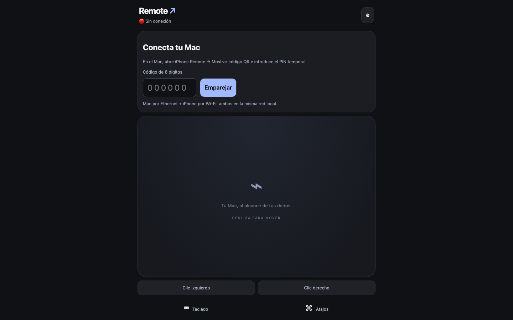
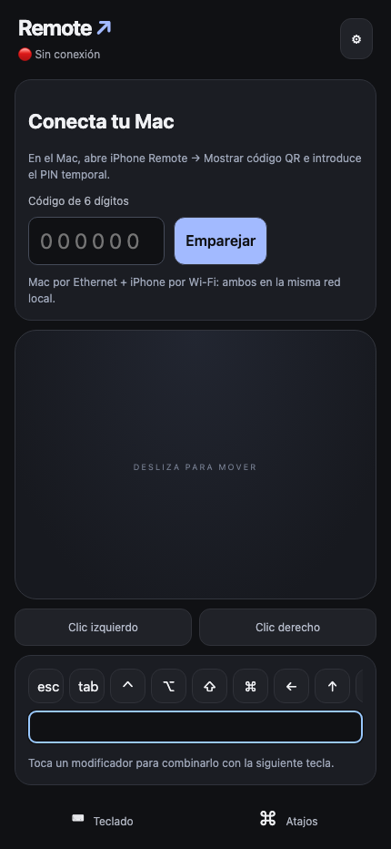
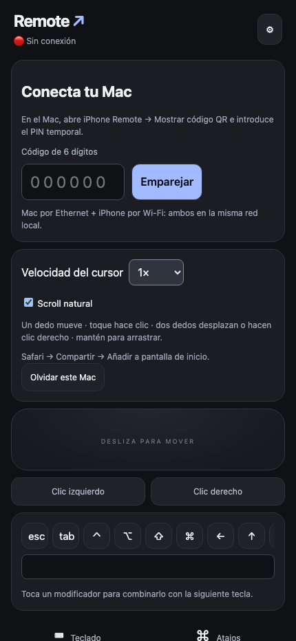

# iPhone Remote

Aplicación nativa de barra de menús para usar un iPhone como trackpad y teclado del Mac. Swift, SwiftUI/AppKit, Network.framework y CGEvent. Sin captura de pantalla, VNC, Electron, Python, Node ni servicios externos durante el uso normal.

## Galería

<table>
<tr>
<td align="center" valign="top"><br><sub>Control remoto en móvil</sub></td>
<td align="center" valign="top"><br><sub>Teclado táctil</sub></td>
</tr>
<tr>
<td align="center" valign="top"><br><sub>Acceso a los ajustes</sub></td>
</tr>
</table>

## Empezar con la aplicación compilada

1. En Finder abre `build/` y arrastra **iPhone Remote.app** a **Aplicaciones**. Cierra cualquier copia abierta antes de moverla. No ejecutes dos copias a la vez.
2. Abre la app desde Aplicaciones. Aparece el icono de un mouse en la barra de menús. La ventana inicial se puede cerrar; el servidor sigue funcionando.
3. Pulsa **Abrir ajustes de Accesibilidad**. En Configuración del Sistema → Privacidad y seguridad → Accesibilidad, habilita **iPhone Remote**. Si no aparece, añádela con `+` desde Aplicaciones. El estado de la app cambiará a **✓ Permitido**. No requiere Grabación de pantalla ni Monitorización de entrada.
4. Si macOS pregunta por conexiones entrantes o acceso a la red local, permite el acceso para esta app.
5. Conecta el iPhone al Wi-Fi del mismo router/LAN al que está conectado el Mac por Ethernet. No es necesario que el Mac use Wi-Fi. Evita una red de invitados con aislamiento de clientes.
6. En el menú del Mac, pulsa **Mostrar código QR**. Escanea con Cámara en el iPhone, abre en Safari e introduce el PIN que muestra el Mac. Caduca en 120 segundos y solo sirve una vez.
7. En Safari: **Compartir → Añadir a pantalla de inicio**. Usa el nombre **Remote** y, si aparece, activa **Abrir como app web**. Abre Remote desde su icono. Si iOS utiliza almacenamiento separado para la app instalada, genera un nuevo PIN y empareja una vez desde Remote.
8. En Configuración del Mac activa **Iniciar al iniciar sesión**, después de instalar la app en Aplicaciones. Se usa `SMAppService.mainApp`, sin scripts ni agentes instalados manualmente. Si requiere aprobación, pulsa el botón para abrir Ítems de inicio en los ajustes de macOS.

Dirección prevista para este Mac: **http://mac.local:8765**. La dirección real, las IP actuales y el QR aparecen en la app. El QR usa `.local` por defecto y no contiene credenciales. Puedes seleccionar la IP como respaldo.

## Requisitos y compilación

- macOS 13 Ventura o posterior, Intel o Apple Silicon.
- Safari en iPhone; se recomienda iOS 16 o posterior por las unidades de viewport dinámico utilizadas.
- Misma LAN, con TCP 8765 y mDNS disponibles entre Ethernet y Wi-Fi.
- Para desarrollar: Swift 5.8 o posterior y SDK macOS 13.3 o posterior. Xcode completo es opcional para el script de compilación.

Entorno inspeccionado: macOS **14.8.9**, **Intel x86_64**, Swift **5.8.1**, SDK **13.3**. Xcode completo no estaba instalado; sí Command Line Tools. No se modificó Python, Homebrew ni la selección global de herramientas.

### Abrir en Xcode

Abre `iPhoneRemote.xcodeproj`, elige el esquema **iPhoneRemote**, destino **My Mac**, y Product → Build / Run. El producto se llama **iPhone Remote.app**. El proyecto usa firma local ad hoc. Para distribución a otros equipos, configura tu equipo de Apple Developer, firma Developer ID y notarización; esta entrega local no está notarizada.

El proyecto Xcode se ha validado como plist, pero no se ha compilado con Xcode porque no está instalado en este Mac. El código y la app se compilan con `swiftc` y las herramientas nativas disponibles.

### Compilar con Command Line Tools (solo desarrollo)

```sh
./scripts/build.sh
```

Resultado: `build/iPhone Remote.app`. No descarga dependencias. Compila para la arquitectura del equipo; en este Mac el binario es Intel. El script comprueba la firma. Los iconos ya están incluidos; para regenerarlos se puede ejecutar `swift scripts/icons.swift "$PWD"` y `iconutil -c icns build/AppIcon.iconset -o Resources/AppIcon.icns`.

## Uso del control

| Gesto / botón | Resultado |
| --- | --- |
| Un dedo | Movimiento con umbral de 4 puntos y aceleración adaptativa |
| Toque | Clic izquierdo; espera hasta 280 ms para distinguir doble toque |
| Doble toque | Doble clic nativo sin un clic adicional |
| Mantener 380 ms y mover | Arrastrar; levanta el dedo para soltar |
| Doble toque y mantener / mover | Arrastrar; el segundo contacto inicia el arrastre |
| Dos dedos y deslizar | Scroll vertical y horizontal proporcional |
| Toque de dos dedos | Clic derecho |
| Botones izquierdo/derecho | Clic inmediato |
| ⚙ | Sensibilidad 0.5× a 2× y dirección del scroll |
| ⌨︎ | Teclado del iPhone y barra de teclas especiales |
| ⌘ Atajos | Copiar, pegar, deshacer, seleccionar todo, cerrar, nueva pestaña, buscar y volumen |

Los modificadores de la barra son seleccionables: toca ⌘ y luego escribe C; puedes seleccionar varios (por ejemplo ⌘ + ⇧). Se desactivan después de la siguiente tecla. Es una alternativa táctil a mantenerlos físicamente. El texto normal se envía como Unicode UTF-16, preservando grafemas, acentos y pares sustitutos; no se traduce a keycodes. Los atajos utilizan posiciones de teclas macOS para letras latinas y teclas especiales, por lo que distribuciones de teclado no latinas pueden requerir ajustes.

Los eventos se agrupan como máximo una vez por frame visual. Los clics y cambios de arrastre vacían primero los movimientos pendientes. Un heartbeat de 1 Hz mantiene la sesión mientras la página está visible; no hay bucles de alta frecuencia en reposo. Al ocultarse se sueltan las teclas y el mouse y se cierra el WebSocket. Al volver se reconecta con backoff de 0.5 a 15 segundos y jitter. Los eventos atrasados no se reproducen al reconectar.

## Arquitectura

```text
Safari / Remote en iPhone
       │ HTTP + WebSocket, LAN TCP 8765
       ▼
iPhone Remote.app (barra de menús)
       ├── HTTP: interfaz y emparejamiento
       ├── WebSocket: autenticación → eventos
       ├── Llavero: hashes de tokens y dispositivos
       ├── Bonjour: _iphoneremote._tcp
       ├── CGEvent: mouse / teclado Unicode
       └── SMAppService: inicio de sesión
```

- `Sources/App.swift`: ciclo de vida, menú, configuración SwiftUI, QR, direcciones, inicio automático.
- `Sources/Server.swift`: servidor TCP Network.framework, HTTP acotado y subconjunto de WebSocket RFC 6455 necesario para el cliente.
- `Sources/Security.swift`: PIN, bloqueo y autorización persistida en Keychain.
- `Sources/Input.swift`: CGEvent, estado de arrastre/teclas y CoreAudio.
- `Resources/Web/`: interfaz autónoma sin frameworks, manifest e iconos.
- `Tests/`: servidor de prueba aislado, integración real y pruebas del cliente en navegador.

Solo se acepta un controlador autenticado simultáneamente. Las operaciones de red y entrada se serializan en la cola principal para mantener el orden. La desconexión libera la entrada. Un watchdog suelta mouse y teclas tras tres segundos sin eventos/heartbeat. El servidor publica Bonjour y comprueba las direcciones cada cinco segundos, además de recibir cambios de red. Safari no dispone de una API para enumerar Bonjour: el descubrimiento práctico es QR + nombre estable `nombre-del-Mac.local`. Si cambia el nombre del Mac, crea nuevamente el acceso de pantalla de inicio.

## Seguridad y límites deliberados del MVP

- Emparejamiento iniciado desde el Mac. PIN aleatorio de seis dígitos, 120 segundos, un solo uso. Cinco errores bloquean el emparejamiento durante cinco minutos; regenerar el PIN no elimina el bloqueo. El contador es global para evitar evadirlo cambiando de IP. Reiniciar el proceso reinicia el bloqueo.
- Token de 256 bits generado con `SecRandomCopyBytes`. El Mac conserva solo SHA-256 del token junto con el registro del dispositivo, dentro del Llavero y sin sincronización entre equipos. Comparación de hashes en tiempo constante. Si falla la escritura al Llavero no se autoriza el dispositivo.
- El iPhone guarda su token en `localStorage`, ligado al origen de la app. No hay scripts de terceros. Safari no permite a esta web escribir directamente en el Llavero nativo. Navegación privada, borrado de datos, cambio entre IP y `.local` o almacenamiento separado de la app instalada pueden requerir volver a emparejar.
- **HTTP y WebSocket no están cifrados.** Un participante capaz de observar o manipular el tráfico de la LAN puede robar el PIN/token o el texto enviado. El emparejamiento no sustituye TLS. Usa una LAN de confianza; esta versión no se debe publicar en Internet ni utilizar en redes compartidas no confiables. No hay UPnP, apertura automática del router ni conexión a la nube. TLS con una identidad confiable por iOS queda fuera de este MVP, pues exige resolver instalación/confianza de certificados o un dominio.
- El listener descarta interfaces celulares/otras, y acepta pares con direcciones IPv4 privadas/link-local/loopback o IPv6 ULA/link-local/loopback. No anuncia ni acepta deliberadamente direcciones públicas. El listener TCP usa el puerto local 8765 y valida el extremo antes de procesar datos. Un proxy o reenvío configurado externamente puede cambiar el modelo de confianza: no lo uses para exponer el puerto.
- Se valida `Host` contra los nombres/IP del Mac, y `Origin` para emparejamiento y WebSocket. No hay CORS abierto. CSP limita scripts, recursos y framing al origen local. Sin tokens en URLs, QR ni logs.
- Límites: 32 conexiones, 20 dispositivos autorizados, 8 KiB de cabeceras HTTP, 4 KiB de cuerpo HTTP, 16 KiB por frame, 240 frames/s por conexión y colas de salida acotadas. Se exige máscara en frames de cliente. Los frames fragmentados y extensiones WebSocket se rechazan deliberadamente; el cliente incluido envía mensajes pequeños y completos. No es un servidor web de propósito general.
- **Dispositivos autorizados → Revocar** elimina la credencial y cierra su conexión. **Revocar todos** hace lo mismo para todos. **Desconectar dispositivos** cierra sesiones pero conserva la autorización, así que pueden reconectarse; para impedir el acceso usa Revocar.
- No se guardan textos tecleados ni capturas. El servidor solo entrega una lista explícita de archivos empaquetados, nunca carpetas del usuario.

## PWA, multimedia y otras limitaciones

- Incluye manifest, iconos PNG, `apple-touch-icon`, modo standalone, safe areas y `viewport-fit=cover`. Es una web app de pantalla de inicio; no incluye service worker/offline porque se sirve mediante HTTP en la LAN, sin contexto HTTPS seguro. Una página ya abierta intenta reconectar cuando el Mac despierta; una apertura en frío con el Mac apagado no puede cargar la interfaz hasta que esté disponible.
- El volumen y silencio usan CoreAudio público. Algunos dispositivos (HDMI, interfaces USB o salidas sin control maestro por software) no permiten modificarlo; se muestra un error explícito. No se simulan teclas multimedia con APIs privadas.
- ⏮ / ⏯ / ⏭ están visibles pero deshabilitados: no se implementó un control multimedia global fiable mediante APIs públicas. Se omiten hápticos porque Safari no ofrece una API general adecuada para esta interfaz.
- No se despierta el Mac mediante Wake-on-LAN. La app funciona después de iniciar sesión y cuando el Mac está despierto. No controla FileVault ni la pantalla previa al inicio de sesión.
- No se cambia automáticamente el permiso de Accesibilidad: macOS requiere la aprobación del usuario. Al recompilar una app con firma ad hoc puede ser necesario quitar y volver a añadir su autorización. Para distribución estable conviene una identidad de firma permanente.

## Pruebas

Compilación nativa optimizada y validación `codesign --verify --deep --strict`. El servidor de pruebas usa una entrada temporal e independiente del Llavero; la elimina al finalizar y no inyecta entrada en otras aplicaciones.

```sh
xcrun swiftc -target "$(uname -m)-apple-macosx13.0" Sources/Security.swift Sources/Input.swift Sources/Server.swift Tests/Harness.swift -o build/test-server
node Tests/integration.mjs
node Tests/browser.mjs
```

Node solo es una herramienta opcional de pruebas; no se empaqueta ni se ejecuta con la app. `browser.mjs` utiliza Chrome ya instalado y un perfil temporal. No toca el perfil habitual. Los mocks del navegador evitan enviar mouse/teclado al Mac.

La integración verifica servicio de recursos, CSP, Host/Origin, traversal, rechazo de comandos no autenticados, PIN incorrecto y de un solo uso, token aleatorio, autenticación, exclusión de un segundo controlador, heartbeat, ping/pong, rechazo de frames sin máscara, reconexión y reensamblado TCP. El harness verifica bloqueo del PIN, persistencia en Llavero y revocación.

Pendiente de validación manual en hardware: gestos y teclado de Safari real en el iPhone, sensación/latencia en tu Wi-Fi, inyección de eventos después de conceder Accesibilidad, comportamiento de inicio automático tras cerrar sesión y control de volumen de la salida utilizada. Las pruebas automatizadas no sustituyen estas comprobaciones y no se afirma haberlas realizado.

## Solución de problemas

- **Safari no abre `.local`:** comprueba que iPhone y Ethernet estén en la misma LAN, sin Wi-Fi de invitados, VPN que aísle tráfico, VLAN separada ni aislamiento AP. En el Mac selecciona **Usar IP como respaldo en el QR**. Si funciona por IP, el problema es mDNS; usa la IP temporalmente o permite multicast en el router. El icono instalado con una IP antigua no se actualiza solo.
- **No conecta por ninguna dirección:** verifica que la app diga Activo y el Mac esté despierto. Revisa el firewall de macOS y permite conexiones entrantes a iPhone Remote, sin desactivar el firewall globalmente. Si aparece, concede Red local. El servidor reintenta cada cinco segundos después de un fallo.
- **Conectado, pero no mueve/escribe:** activa Accesibilidad para la copia exacta de Aplicaciones. Si cambió la firma al recompilar, quita la entrada antigua y añade la nueva. Algunas superficies protegidas de macOS pueden impedir entrada sintética.
- **PIN incorrecto/caducado:** genera otro en el Mac; si hubo cinco errores, espera cinco minutos. Después de un emparejamiento ese PIN ya no es válido.
- **Otro dispositivo está controlando:** cierra Remote/Safari en el otro dispositivo o desconecta desde el menú del Mac.
- **Puerto ocupado:** cierra otras copias de iPhone Remote. El puerto 8765 es fijo para conservar el origen y las credenciales; no se selecciona uno aleatorio silenciosamente.
- **Tecla o arrastre atascado:** vuelve a abrir Remote o usa Desconectar dispositivos. La app libera automáticamente el estado al perder la conexión y con el watchdog de tres segundos.
- **No inicia con macOS:** instala en Aplicaciones antes de activar la opción; revisa Ajustes del Sistema → General → Ítems de inicio. Desactiva y vuelve a activar la opción después de mover la app.
- **Acceso directo abre sin emparejamiento anterior:** Safari y la app instalada pueden tener almacenamiento diferente; empareja desde la app instalada y conserva el mismo origen `.local`.

Referencias oficiales: [SMAppService](https://developer.apple.com/documentation/servicemanagement/smappservice/mainapp), [configuración de web apps Safari](https://developer.apple.com/library/archive/documentation/AppleApplications/Reference/SafariWebContent/ConfiguringWebApplications/ConfiguringWebApplications.html), [añadir una web a la pantalla de inicio](https://support.apple.com/en-ph/guide/iphone/iphea86e5236/ios).
